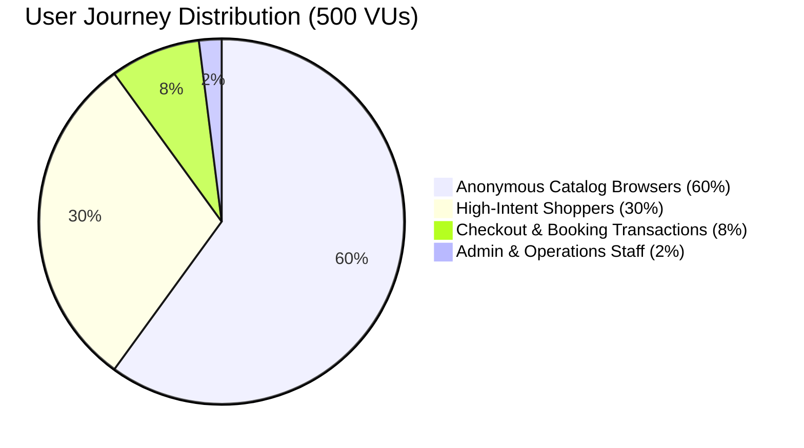
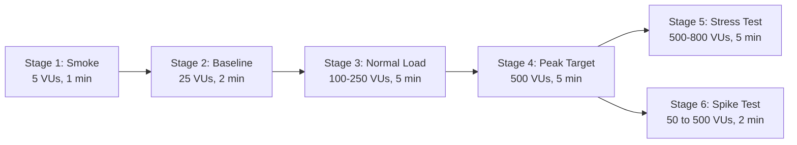

# Phase 5 — Performance & Load Test Plan Report

**Document ID:** PR-REP-005  
**Date:** 2026-10-19  
**Status:** PASS  
**Phase:** 5 — Performance & Load Test Planning  
**Auditor / Roles:** Performance & Load Testing Engineer, DevOps / SRE, Software Architect  

---

## 1. Executive Summary

This document establishes the official Performance, Load, and Stress Testing Plan for the **GouNow Lifestyle Platform** to empirically determine system capacity, latency distributions, and concurrency boundaries under a target workload of **500 concurrent virtual users (VUs)**.

The plan formalizes:
1. A realistic **90/10 Read-to-Write Workload Model** derived from real-world luxury hospitality and short-term rental user journeys.
2. Quantifiable **Service Level Objectives (SLOs)** across latency percentiles ($p_{50}, p_{95}, p_{99}$) and error budgets.
3. A six-stage test execution progression (Smoke, Baseline, Normal Load, Peak Load, Stress, and Spike testing).
4. Concrete resource saturation thresholds (CPU, RAM, DB connection locks, background worker lag).

---

## 2. Workload & Traffic Model (500 Concurrent Users)

Based on behavioral profiling of platform users during peak seasons in El Gouna:

### User Journey Breakdown

| Persona | Weight (%) | Concurrent VUs | Primary Endpoints Hit | Pacing / Think Time |
|---|---|---|---|---|
| **Anonymous Browser** | 60% | 300 VUs | `GET /api/v1/stays` `GET /api/v1/experiences` `GET /api/v1/homepage` | 1.0s – 3.0s |
| **High-Intent Shopper** | 30% | 150 VUs | `GET /api/v1/stays/{slug}` `POST /api/v1/stays/{slug}/check-availability` `GET /api/v1/properties/{id}/pricing-calendar` | 2.0s – 4.0s |
| **Checkout Buyer** | 8% | 40 VUs | `POST /api/v1/checkout/quote` `POST /api/v1/checkout/process` `GET /checkout/mock/card/{ref}` | 3.0s – 6.0s |
| **Admin / Ops Staff** | 2% | 10 VUs | `GET /api/v1/admin/pricing/overview` `GET /api/v1/admin/bookings` `POST /api/v1/admin/properties/parse-location` | 5.0s – 10.0s |

---

## 3. Service Level Objectives (SLOs) & Performance Budgets

All tests will be evaluated against strict Service Level Objectives defined across percentiles:

| Category | Endpoint Scope | $p_{50}$ (Median) | $p_{95}$ Target | $p_{99}$ Maximum | Max Error Rate |
|---|---|---|---|---|---|
| **Catalog & Static Reads** | `GET /api/v1/stays`, `GET /api/v1/experiences` | $\le 50\text{ ms}$ | $\le 200\text{ ms}$ | $\le 400\text{ ms}$ | $< 0.05\%$ |
| **Entity Details & Filters** | `GET /api/v1/stays/{slug}` | $\le 60\text{ ms}$ | $\le 250\text{ ms}$ | $\le 500\text{ ms}$ | $< 0.1\%$ |
| **Availability Matrix** | `POST /api/v1/stays/{slug}/check-availability` | $\le 75\text{ ms}$ | $\le 300\text{ ms}$ | $\le 600\text{ ms}$ | $< 0.1\%$ |
| **Pricing Calculation** | `POST /api/v1/checkout/quote` | $\le 100\text{ ms}$ | $\le 400\text{ ms}$ | $\le 800\text{ ms}$ | $< 0.1\%$ |
| **Booking Creation** | `POST /api/v1/checkout/process` | $\le 150\text{ ms}$ | $\le 500\text{ ms}$ | $\le 1000\text{ ms}$ | $< 0.1\%$ |
| **Overall Platform** | All endpoints aggregate | $\le 80\text{ ms}$ | $\le 350\text{ ms}$ | $\le 750\text{ ms}$ | $< 0.1\%$ (HTTP 5xx) |

### Non-Negotiable Pass/Fail Criteria
- **Zero Double-Bookings:** Even under maximum concurrency on overlapping dates for the exact same inventory item.
- **Zero Database Lock Failures:** Zero instances of `SQLSTATE[HY000]: General error: 5 database is locked`.
- **Zero Data Leakage:** Responses under load must never leak unredacted customer data, auth tokens, or internal notes.

---

## 4. Test Stages Definition

### Stage Details

1. **Stage 1 — Smoke Test:**
   - **Target:** 5 VUs for 60 seconds.
   - **Objective:** Verify test script validity, target server reachability, response code assertions, and synthetic data parsing.
2. **Stage 2 — Baseline Load Test:**
   - **Target:** 25 VUs for 2 minutes.
   - **Objective:** Establish the low-load baseline latency profile for all endpoints without resource contention.
3. **Stage 3 — Normal Sustained Load Test:**
   - **Target:** Ramp from 25 to 250 VUs over 2 minutes, sustain 250 VUs for 3 minutes.
   - **Objective:** Measure standard production operation, monitoring query queue depth and memory stability.
4. **Stage 4 — Peak Capacity Test (500 VUs):**
   - **Target:** Ramp to 500 VUs over 2 minutes, sustain 500 VUs for 3 minutes.
   - **Objective:** Directly test the user's primary requirement (500 concurrent users). Measure $p_{95}$ latency degradation and identify SQLite WAL checkpoint bottlenecks.
5. **Stage 5 — Stress & Saturation Test:**
   - **Target:** Ramp beyond 500 VUs up to 800 VUs until error rate $> 1\%$ or $p_{95} > 2000\text{ ms}$.
   - **Objective:** Identify the exact breaking point of the single-node architecture.
6. **Stage 6 — Spike Test:**
   - **Target:** Immediate jump from 50 VUs to 500 VUs within 15 seconds, sustain 60 seconds, drop back.
   - **Objective:** Test system recovery, connection pool resilience, and rate-limiter recovery.

---

## 5. Resource Saturation Thresholds & Monitoring

| Resource Metric | Normal Threshold | Warning Threshold | Critical Saturation (Fail) |
|---|---|---|---|
| **CPU Utilization** | $\le 60\%$ | $60\% - 80\%$ | $> 85\%$ sustained |
| **Memory Utilization** | $\le 65\%$ | $65\% - 80\%$ | $> 85\%$ or OOM killing |
| **Disk I/O Wait (WAL)** | $\le 5\%$ | $5\% - 15\%$ | $> 20\%$ |
| **Database Locks** | 0 locks | $< 3$ retried locks | $\ge 1$ unhandled lock exception |
| **HTTP 5xx Errors** | 0 errors | $0.01\% - 0.1\%$ | $> 0.1\%$ |

---

## 6. Execution Tooling & Environment Requirements

1. **Load Generator:** `k6` (or Node.js high-concurrency runner if k6 binary is absent).
2. **Server Architecture:**
   - Backend running via PHP CLI multi-worker server (`PHP_CLI_SERVER_WORKERS=4` on dedicated test port `8001`) or PHP-FPM container.
   - SQLite configured with `PRAGMA journal_mode = WAL; PRAGMA synchronous = NORMAL; PRAGMA busy_timeout = 5000;`.
3. **Data Pre-requisites:**
   - Database populated with 50+ properties, seasonal price rules, test user tokens, and availability blocks.
   - Idempotency key generators for checkout requests to prevent duplicate synthetic charges.

---

## 7. Phase 5 Exit Gate Evaluation

| Criteria | Standard | Status |
|---|---|---|
| Workload Model Defined | 500 VUs, 90/10 Read/Write ratio, 4 personas | **PASS** |
| SLOs Defined | Clear latency percentiles ($p_{50}, p_{95}, p_{99}$) and error budgets | **PASS** |
| Test Stages Formalized | 6 test stages from Smoke to Spike & Stress | **PASS** |
| Resource Saturation Guardrails | Defined for CPU, RAM, Disk I/O, DB locks | **PASS** |

**Phase 5 Overall Status:** **PASS**
